  <h1>Chinmoy Jyoti Bora</h1>
  

    
  

  

    <strong>I build AI agents and agentic process automation, train compact vision models for real hardware, and turn messy data into systems you can query, evaluate, and trust.</strong>
  

  

    
    
    
    
  

  
<code>chinmoy.bora177@gmail.com</code>

---

## About

Dual-degree **M.Sc. in AI and Data Science** at [TH Deggendorf](https://www.th-deg.de/) and the [University of South Bohemia](https://www.jcu.cz/en) (current GPA Ø 2.0). Previously **B.Sc. Information Technology** at [St. Xavier’s College, Mumbai](https://xaviers.edu/) (7.23 CGPA).

Looking for **Werkstudent / internship** roles in ML, data engineering, and AI software (agents, RAG, industrial and vision AI).

I work across **AI agents**, **on-device computer vision**, **RAG systems**, and **applied data science**, from human-in-the-loop agent workflows to YOLO on a Raspberry Pi and retrieval pipelines you can actually score.

- Intern, Diginique TechLab: end-to-end movie recommendation system (TF-IDF / SVD, scikit-learn)
- OCI 2025 Certified AI Foundations Associate · Google Data Analytics Professional Certificate

**Currently focused on**
- AI agents and agentic process automation (human-in-the-loop review, policy guardrails)
- RAG evaluation, local knowledge graphs, and training-free industrial vision

---

<h2 align="center">Tech stack</h2>

<table width="100%">
  <tr>
    <td align="center" valign="top" width="50%">
      <h3>Languages</h3>
      

        
        
        
        
      

    </td>
    <td align="center" valign="top" width="50%">
      <h3>ML & Computer Vision</h3>
      

        
        
        
        
        
        
      

    </td>
  </tr>
  <tr>
    <td align="center" valign="top" width="50%">
      <h3>LLM, RAG & Agents</h3>
      

        
        
        
        
        
        
        
        
      

    </td>
    <td align="center" valign="top" width="50%">
      <h3>Frontend & Data</h3>
      

        
        
        
        
        
        
        
      

    </td>
  </tr>
  <tr>
    <td align="center" valign="top" colspan="2">
      <h3>Hardware</h3>
      

        
        
      

    </td>
  </tr>
</table>

---

## Featured projects

### SubspaceAD

Training-free few-shot anomaly detection via DINOv2 subspace modeling. From-scratch reproduction of [arXiv:2602.23013](https://arxiv.org/abs/2602.23013) on MVTec-AD and VisA (`k ∈ {1,2,4}`, 5 seeds), plus paper ablations and a Next.js / FastAPI demo.

**Stack:** Python, PyTorch, DINOv2, FastAPI, Next.js

[Repository](https://github.com/Chinmoy-04/Subspacead)

### ShopCrew - PayPal AI Hackathon

AI agents run a one-person shop: they refund customers through the PayPal Agent Toolkit and pay suppliers through PayPal Payouts. Every decision lands in a live AG Grid control room so the owner can approve, edit, or roll it back (orchestrator guardrails, human-in-the-loop). Built for the PayPal AI Hackathon.

**Stack:** TypeScript, Node.js, Fastify, React, AG Grid, PayPal Agent Toolkit

[Repository](https://github.com/Chinmoy-04/ShopCrew-PayPal)

### HelixForge - RAG Eval Engine

Ingest a policy corpus, generate synthetic and hand-authored Q&A, run seven retrieval pipeline configs, score them with Ragas, and compare results in a React dashboard.

**Stack:** FastAPI, LlamaIndex, Chroma, Ragas, React / TypeScript

[Repository](https://github.com/Chinmoy-04/Rag-eval-engine) · [Live dashboard](https://rag-eval-engine.vercel.app/)

### LightRAG Local - _completed_

Local LightRAG knowledge graph on Windows: 30 RAG-focused arXiv papers indexed into a NetworkX graph (~6.5k nodes / ~6.9k edges), with chat, a graph viewer, and a Compare dashboard for naive / local / global / hybrid modes. Ollama for extract and embed; FastAPI + React UI.

**Stack:** LightRAG, Ollama, FastAPI, React, NetworkX

[Repository](https://github.com/Chinmoy-04/lightrag-local)

### VibeGuide - Qloo Agentic Hackathon

Taste-based travel concierge that turns music, food, and media preferences into city itineraries via Qloo's cultural AI API, with Gemini narratives and a refine agent for thumbs-up / thumbs-down feedback. Backend and Qloo pipeline by me; frontend by Armita Bora. Built for the Qloo Agentic Hackathon.

**Stack:** Python, FastAPI, React, Qloo API, Gemini

[Repository](https://github.com/armitabora/qloo)

### Interactive Air-Gesture Touchless Controller

Trained **YOLO11n** to recognise 6 hand gestures (**95.9% precision, 96.9% recall, 98.1% mAP50**) and deployed it on a **Raspberry Pi 5** with a **Sony IMX500** on-sensor NPU for real-time, camera-only control of presentations, media, cursor, and desktop.

**Stack:** YOLO11n, Raspberry Pi 5, Sony IMX500

[Repository](https://github.com/Chinmoy-04/air-gesture-controller)

### Public Health Data Visualization - German Air Quality

Aggregated environmental and healthcare records into a unified dataset (5 years × 16 German states) with **R / tidyverse**, correlating **PM10** and **NO2** with age-standardised respiratory mortality. Interactive **Next.js** dashboard for the story the numbers tell.

**Stack:** R, tidyverse, Next.js

[Repository](https://github.com/Chinmoy-04/German-air) · [Live dashboard](https://german-air.vercel.app)

### Ensemble Inference Pipeline - Krones Challenge

Binary image classifier (reusable vs. non-reusable containers) for the Kaggle **1st Krones Vision AI Challenge**, using ROI crops from conveyor-line imagery. Iterated through 18 experiment generations to a dual-backbone **ConvNeXt-Large + EfficientNetV2-M** ensemble with k-fold CV, TTA, F1-optimal thresholding, and ONNX export.

**Stack:** PyTorch, ConvNeXt, EfficientNetV2, ONNX

[Repository](https://github.com/Chinmoy-04/Industrial-Bottle-Inspection-System-Binary-)

---

<h2 align="center">GitHub stats</h2>

<table width="100%">
  <tr>
    <td align="center" width="50%">
      
    </td>
    <td align="center" width="50%">
      
    </td>
  </tr>
</table>

---

Thanks for stopping by. The interesting work is in the repos above.

